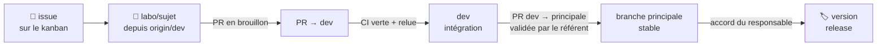

# 🏛️ Gouvernance

Organisation **gripforgeai** · qui décide quoi, et comment le travail entre dans la branche principale.

## Rôles

| Rôle | Qui | Décide |
|---|---|---|
| 👑 **Responsable** | le fondateur de GripForge | les versions publiées, les déploiements, les décisions d'architecture et de licence, ces règles |
| 🧭 **Référent de zone** | un membre par zone (site, gamekits, tools-chain, MCP) | relit et valide les PR de sa zone, garde sa CI verte, prépare les PR `dev → branche principale` |
| 🛠️ **Membres de l'équipe** | personnes autorisées de l'organisation | ouvrent et relisent les PR vers `dev` |
| 🤖 **Agents IA** | Claude, Codex, Gemini… lancés par un membre | travaillent sur une branche par tâche ; ouvrent des PR en brouillon, **ne fusionnent jamais** |

## Le chemin d'un changement

1. **Tâche** : une issue sur le kanban, une branche `labo/<sujet>` créée depuis `origin/dev`.
2. **`dev`** = intégration : on y entre par PR, **après une CI verte** et une relecture par quelqu'un d'autre que
   l'auteur. Plusieurs PR liées peuvent être **empilées** (voir `CONTRIBUTING.md`).
3. **Branche principale** (`main` ou `master`) = ce qui a été relu et validé, par une PR `dev → branche principale`.
4. **Version** : étiquette sur la branche principale, avec l'accord du responsable ; elle publie les paquets et peut
   déployer.

> [!NOTE]
> Le plan gratuit de GitHub ne protège pas les branches des dépôts privés : ces règles tiennent parce qu'on les
> respecte (et grâce au hook `pre-push` de chaque dépôt).

## Décisions

- Une décision n'est officielle qu'une fois écrite dans une **issue** ou dans le dépôt (`docs/decisions/`), pas
  seulement sur Discord. Une PR qui applique une décision la cite.
- Le suivi des tâches a une **source unique** : le [kanban](https://github.com/orgs/gripforgeai/projects/1).
- Licences : production = MIT, BSD, Apache 2.0 ; tout ce qui est plus restrictif reste en essai.

## Changer ces règles

Une PR qui modifie ce fichier, `CONTRIBUTING.md` ou `CODE_OF_CONDUCT.md` demande l'accord du responsable et des
référents.
