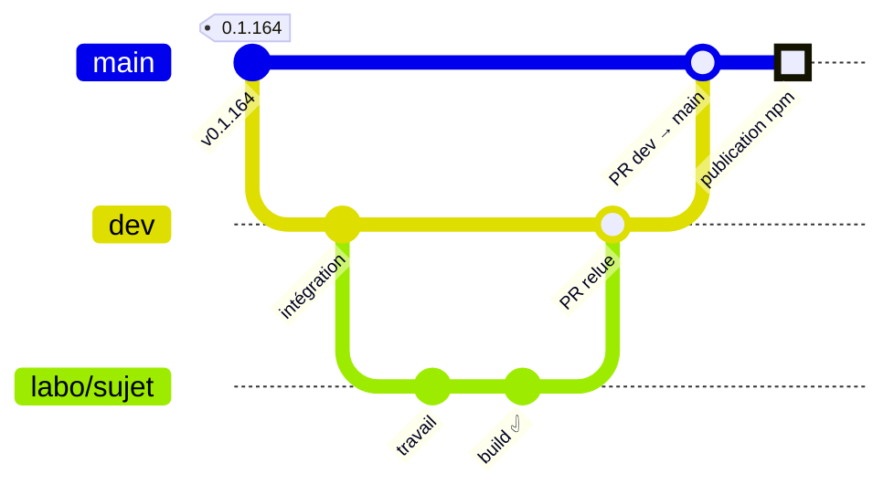
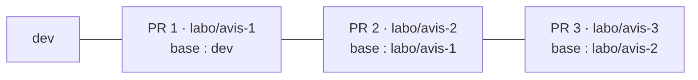

# 🤝 Contribuer à mcp

Serveur MCP de GripForge (« The tools your AI needs to make your games »), organisation `gripforgeai`. Ce dépôt est
**public** : n'y écrivez rien d'interne (machines, runners, adresses, dépôts privés). Qui décide quoi :
[GOVERNANCE.md](.github/GOVERNANCE.md) · règles de l'équipe : [CODE_OF_CONDUCT.md](.github/CODE_OF_CONDUCT.md).

<!-- modele:essentiel:debut -->

## 📜 L'essentiel (charte commune de GripForge)

Ces règles sont les mêmes dans tous les dépôts de l'organisation `gripforgeai`. Les tâches sont sur le
[**kanban**](https://github.com/orgs/gripforgeai/projects/1) ; qui décide quoi : [GOVERNANCE.md](.github/GOVERNANCE.md) ;
comment on se parle : [CODE_OF_CONDUCT.md](.github/CODE_OF_CONDUCT.md).

**Une fois par clone**, activez le garde-fou qui refuse les push directs vers `main`, `master` et `dev` :

```sh
git config core.hooksPath .githooks
```

1. **Jamais de push direct sur la branche principale ni sur `dev`.** Tout passe par une PR, même une ligne (le hook
   `pre-push` vous le rappelle).
2. **Une issue par tâche**, ajoutée au kanban. Pas d'issue, pas de PR (sauf correction d'une faute de frappe).
3. **Une branche par sujet**, nommée `labo/<sujet>` (ex. `labo/barre-de-vie`), partie de `origin/dev`, sans nom de
   personne. Les agents IA suivent la même règle.
4. **PR en brouillon dès le début**, vers `dev` : `gh pr create --draft --base dev` ; `gh pr ready <n°>` quand vous
   voulez la CI complète et une relecture.
5. **Titre clair** (« Combat : barres de vie des ennemis ») ; dans la description, `Closes #12` pour l'issue traitée.
6. **Petites PR** : moins de 400 lignes utiles, sinon une pile de PR (voir plus bas). Testez d'abord sur votre machine
   ce que vous avez touché.
7. **On fusionne du vert**, après au moins une relecture par quelqu'un d'autre que l'auteur. Un échec déjà présent
   sur `dev` ne bloque pas, mais se signale (étiquette `déjà-rouge`).
8. **Aucun secret, prénom, pseudo, adresse IP ni chemin de disque** dans le code, les commits, les PR et les docs.

| Quoi | Où |
|---|---|
| 🔨 Proposer une tâche ou signaler un bug | onglet **Issues** → formulaire (pas d'issue vide) |
| 🗂️ Suivre le travail | [kanban de l'organisation](https://github.com/orgs/gripforgeai/projects/1) |
| 💬 Une question | [SUPPORT.md](.github/SUPPORT.md) |
| 🔐 Une faille, un secret exposé | [SECURITY.md](SECURITY.md) — jamais dans une issue |
| 🤖 Agents IA | mêmes règles, en plus strict : PR en brouillon, étiquette `agent`, jamais de fusion ; voir `AGENTS.md` |

<!-- modele:essentiel:fin -->

<details>
<summary><b>📑 Sommaire</b></summary>

- [📜 L'essentiel (charte commune)](#-lessentiel-charte-commune-de-gripforge)
- [🌿 Cycle des branches](#-cycle-des-branches)
- [🧱 PR empilées (« stack »)](#-pr-empilées--stack-)
- [🛠️ Installer et lancer](#️-installer-et-lancer)
- [✅ Avant d'ouvrir une PR](#-avant-douvrir-une-pr)
- [⚙️ La CI de ce dépôt](#️-la-ci-de-ce-dépôt)
- [📦 Versions](#-versions)
- [💻 Code](#-code)

</details>

> [!IMPORTANT]
> **D'où vient le code ?** Une partie de ce dépôt (les fichiers `src/*.generated.ts`, `publish.yml`, les versions de
> `package.json` et `server.json`) est produite par le dépôt privé du produit, qui pousse sur `main` à chaque version.
> Ne modifiez pas les fichiers `*.generated.ts` à la main : leur en-tête indique « do not edit ». Pour une
> correction dans ces fichiers, ouvrez une issue : le changement se fait à la source.

## 🌿 Cycle des branches

> [!NOTE]
> Ce cycle démarre après la réunion d'équipe. D'ici là, la branche dev est remise à jour depuis la branche principale.



| Branche | Rôle | Qui y écrit |
|---|---|---|
| `labo/<sujet>` | un chantier, créé depuis `origin/dev` | la personne ou l'agent du chantier |
| `dev` | intégration : on y entre **par PR**, après relecture | relecteurs de l'équipe |
| `main` | ce qui est relu et validé ; **chaque push qui change `package.json` publie sur npm** | le responsable (PR `dev → main`) |

> [!IMPORTANT]
> Jamais de travail direct sur `main`, jamais de force push. Rien n'est supprimé (branches, étiquettes, versions npm)
> sans l'accord du responsable. Une version publiée sur npm ne se retire pas : elle se remplace par la suivante.

## 🧱 PR empilées (« stack »)

Quand un chantier se découpe en étapes qui dépendent l'une de l'autre, on **empile** les PR plutôt que d'en faire une
énorme :



1. La PR du dessous vise `dev` ; chaque PR suivante prend **la branche de la précédente comme base** : son diff ne
   montre que sa propre étape.
2. Le corps de chaque PR donne la pile (« 2 / 3, dépend de #66 »).
3. On fusionne **de bas en haut**. Quand la branche du dessous est fusionnée puis supprimée, GitHub reporte
   automatiquement la PR suivante sur `dev`.
4. Une correction dans une PR du dessous : la reporter dans les suivantes par `git merge` (pas de rebase forcé sur une
   branche déjà poussée).

> [!TIP]
> Les commits qui ne touchent que la doc peuvent porter `[skip ci]` dans leur message.

## 🛠️ Installer et lancer

Il faut Node.js 20.3 ou plus (le workflow de publication utilise Node 22).

```sh
npm install
npm run build                      # compile src/ vers dist/ (tsc) ; dist/server.js est le point d'entrée
GRIPFORGE_API_KEY=gf_... node dist/server.js    # serveur MCP en stdio, à brancher sur un client MCP
```

Le serveur démarre et répond à la découverte des outils sans clé (voir le `Dockerfile`) ; la clé n'est exigée que
quand un outil est réellement appelé. Pour parler à un serveur de test plutôt qu'à la production, définir
`GRIPFORGE_API_URL`.

## ✅ Avant d'ouvrir une PR

```sh
npm run build        # doit passer sans erreur de type (tsconfig en mode strict)
```

- [ ] Le build passe ; `dist/` et `node_modules/` ne sont pas commités (`.gitignore`).
- [ ] Un outil est ajouté ou change : mettre à jour `README.md` (§ Tool reference) avec son rôle et son coût en crédits.
- [ ] Une variable d'environnement est ajoutée : la lister dans `README.md` (§ Environment variables). Aucune valeur
      secrète dans le code.
- [ ] Une PR à publier monte la version dans `package.json` **et** `server.json` (les deux champs `version` de
      `server.json` suivent `package.json`).
- [ ] Aucun secret, prénom, pseudo, adresse IP ni chemin de disque dans le diff, les commits et la PR.
- [ ] Le README reste **en anglais** (c'est la vitrine publique) ; le reste de la doc d'équipe est en français.

> [!WARNING]
> Le script `npm test` existe (`node --test test/*.test.mjs`) mais **ce dépôt ne contient pas de dossier `test/`** : la
> commande ne trouve rien à lancer. Il n'y a donc aucun test automatique ici pour l'instant ; le build est le seul
> contrôle.

## ⚙️ La CI de ce dépôt

Un seul workflow, [`publish.yml`](.github/workflows/publish.yml) (« Publier sur npm et au registre MCP »), sur les
runners hébergés par GitHub (`ubuntu-latest`).

| Déclencheur | Ce qu'il fait |
|---|---|
| push sur `main` qui touche `package.json` | publie la version si elle n'est pas déjà sur npm |
| publication d'une GitHub Release | idem |
| lancement à la main (onglet **Actions** → <kbd>Run workflow</kbd>) | idem |

Deux jobs : **`npm`** (vérifie si `nom@version` est déjà sur npm ; sinon `npm install`, `npm run build`, `npm publish`
par « trusted publishing » OIDC, ou avec le secret `NPM_TOKEN` s'il existe) puis **`registry`** (attend que npm serve la
version, `mcp-publisher validate`, publication au registre MCP). Si la version est déjà sur npm, le job `npm` ne publie
rien et se termine vite. Il n'y a **aucun check sur les PR** : ce workflow ne tourne qu'après fusion. Compilez donc
vous-même avant de pousser.

## 📦 Versions

Aujourd'hui, une version sort ainsi : le dépôt privé du produit pousse sur `main` un `package.json` (et `server.json`)
à la nouvelle version ; `publish.yml` la publie sur npm (`@gripforgeai/mcp`) puis au registre MCP
(`io.github.gripforgeai/mcp`). Aucune étiquette `vX.Y.Z` n'est nécessaire. Les versions sont de la forme `0.1.N`
(actuellement `0.1.164`). La procédure exacte pour une contribution venue de l'extérieur n'est pas encore écrite :
voir la question ouverte avec le responsable.

## 💻 Code

- TypeScript en mode `strict`, modules ES (`"type": "module"`, `NodeNext`), cible ES2022 ; dépendances d'exécution
  minimales : `@modelcontextprotocol/sdk` et `zod` (schémas des paramètres des outils).
- Un fichier `src/<famille>-tools.ts` par famille d'outils ; `src/server.ts` les enregistre tous.
- Aucun formateur ni linter n'est configuré : imitez le style du fichier que vous modifiez.
- `runtime/` contient des scripts Python (Unreal) et Node livrés avec le paquet (liste dans `files` de `package.json`).
- Les messages d'erreur et descriptions d'outils sont en anglais (ils sont lus par des agents IA du monde entier).
- Secrets : jamais dans le dépôt (voir [SECURITY.md](SECURITY.md)).
- Le dossier `.gf-bus/` est l'outil de coordination des agents de l'équipe (voir `AGENTS.md`) ; ne le modifiez pas
  dans une PR de fonctionnalité.
